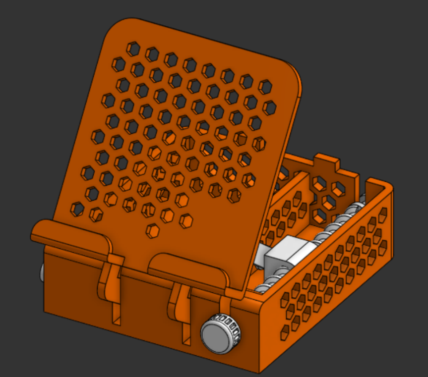
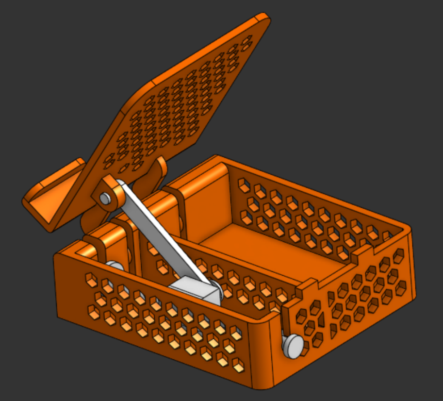

# phone-stand
Phone stand is a simple stand to mount your phone with adjustability.

## What is this?
Phone Stand is basically a simple phone stand to mount your phone, as the name suggests. Designed from scratch in Onshape, it allows you to mount your phone from 200 degrees to 0 degrees (actual useful range: 90-0 degrees). Change the angle with a simple onboard knob. It also has a sleek, cool orange-and-white look.





## Repository Structure
```text
phone-stand/
|
|---- Assets/-----------# Images and visual references for the project
|
|---- Hardware/---------# Source design files for the CAD
|
|---- BOM.csv-----------# Bill of materials
|
|---- LICENSE-----------# MIT License
|
|---- README.md---------# Project documentation and instructions
```

## Live 3d view in Onshape
Click [here](https://cad.onshape.com/documents/47d2c0bef5caa405116c1f2e/w/c4929c2f8c344c4bebdee85c/e/16752cbc6ad0cd7b90376be5) to view Phone Stand in Onshape!

## How to get your own Phone Stand?
1. Download the source CAD .step files from the [Hardware](Hardware/) directory
2. Import the file into your CAD editor and make edits as you want (Optional)
3. Go to your fabricater/ manufacturer website, get a quote, and purchase it (For Example, [ROBU](https://robu.in) or [JLCPCB](https://jlcpcb.com))
4. That's it! Wait for it to arrive and mount your phone!

## [BOM](BOM.csv) as a table
| Item     | Description  | Quantity | Price (USD) | Link                             |
|----------|--------------|----------|-------------|----------------------------------|
| 3D print | PLA (120 gm) | 1        | 6           | https://printlegion.hackclub.com |
| Shipping |              |          | 1           |                                  |
| Total    |              |          | 7           |                                  |

## Fabrication Specs
1. Printer- 0.2 mm Standard Quality
2. Material- PLA
3. Color- Orange & White
4. Infill- 60%

## License
[MIT](LICENSE)- Use, modify, share as you like!

## Notes
- If ya'll like this project, make sure to see my other projects [NFC Card](https://github.com/vd-sh/nfc-card), [Deskr](https://github.com/vd-sh/deskr), or [Cync](https://github.com/vd-sh/cync)
- Or simply visit my [profile](https://github.com/vd-sh) to see the latest projects :)
